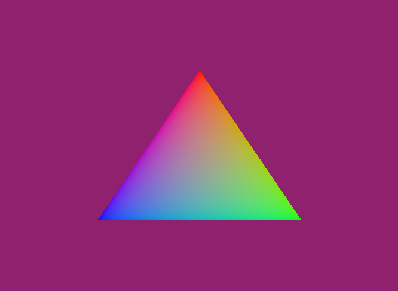

# Lesson 2.2 — The Graphics Pipeline & Your First Triangle

| | |
|---|---|
| **Goal** | Build a `VkPipeline` from your shaders with a small builder class, and draw the triangle from 2.1 |
| **Time** | 1.5–2.5 hours |
| **You'll create** | `vk/PipelineBuilder.h/.cpp` |
| **You'll change** | `renderer/Renderer.h/.cpp` |
| **Prerequisite** | Lesson 2.1 (shaders compile to `.spv`, `loadShaderModule` exists) |



---

## 1. Concepts

### 1.1 What a pipeline is

To draw, the GPU needs to know **everything** about how: which shaders, how vertices are
read, whether to fill triangles or draw outlines, which faces to skip, how to blend, which
image format it's writing to... In Vulkan, all of that is **baked into one object up front**:
the **pipeline** (`VkPipeline`).

```
 VkPipeline  =  vertex shader + fragment shader            (programmable: YOUR code)
              + vertex input layout                         (fixed-function settings:
              + topology, rasterizer, multisample,           switches and dials on the
                depth, blend, attachment formats              GPU's hardware stages)
```

Drawing is then: **bind a pipeline → draw**. To draw something with different settings
(wireframe, another shader, transparency), you **bind another pipeline**.

### 1.2 Why bake everything up front?

Older APIs (OpenGL, DX11) let you change any setting at any time. The driver then had to
check and **recompile shader code behind your back at draw time**, which caused random frame
hitches. Vulkan moves all that work to `vkCreateGraphicsPipelines`: slow once, at load time,
then fast at draw time.

**Tech-art link: this is the famous "PSO stutter".** In Unreal (DX12/Vulkan), a pipeline is
called a **PSO (Pipeline State Object)**. Every unique combination of material, vertex
format and render state needs its own PSO. If one is created the first time something
appears on screen, you get a hitch, which is why Unreal has **PSO caching / precaching**.
When a TA is asked "why does the game hitch the first time this effect plays?", this is
often the answer. You're about to create one PSO by hand.

### 1.3 The stages you configure

Here's the GPU pipeline, with which part is yours and which part is settings:

```
 vertex buffer ─► [Input Assembly] ─► [VERTEX SHADER] ─► [Rasterizer] ─► [FRAGMENT SHADER] ─► [Blend] ─► image
                  group vertices       your .vert         triangle →      your .frag           mix with
                  into triangles                          pixels, cull,                        what's there
                                                          interpolate
```

The builder in this lesson fills one struct per stage. The defaults are deliberately simple:

| Stage | Our default | Changed when |
|---|---|---|
| Vertex input | **none** (positions are inside the shader) | 2.3: vertex buffers |
| Input assembly | triangle list: every 3 vertices = 1 triangle | rarely (lines/points for debug views) |
| Rasterizer | filled, **no culling** | 4.2: wireframe toggle; 3.3: back-face culling |
| Multisample | off | Phase 9 (MSAA) |
| Depth/stencil | off | 3.3: depth buffer |
| Blend | off (the fragment color replaces the pixel) | 4.1: ImGui transparency |
| Dynamic state | viewport + scissor | |
| Rendering formats | the swapchain's format | 3.3: + depth format |

### 1.4 Dynamic state: viewport and scissor

The **viewport** maps clip space (-1..1) onto a rectangle of pixels in the image. The
**scissor** clips drawing to a rectangle. Both depend on the window size, which changes on
resize. If they were baked in, every resize would need a new pipeline. Instead they're
**dynamic state**: the pipeline says "this will be set later", and you call
`vkCmdSetViewport`/`vkCmdSetScissor` while recording each frame.

### 1.5 The pipeline layout

A `VkPipelineLayout` describes **what extra data the shaders can access**: push constants
and descriptor sets (uniform buffers, textures). Your triangle shaders need nothing extra,
so the layout is **empty** for now. Lesson 3.2 fills it with the camera matrices, and Phase 6
with textures.

### 1.6 Pipeline and swapchain format

With dynamic rendering, the pipeline must know the **format** of the image it draws into
(`B8G8R8A8_SRGB` for you), but not the image itself. That's why `VkPipelineRenderingCreateInfo`
replaces `VkRenderPass` here. Swapchain recreation on resize keeps the same format, so the
pipeline survives resizes untouched.

### 1.7 Interpolation: why the triangle is a rainbow

The vertex shader gives each corner one color. The rasterizer then **blends the three corner
values for every pixel**, weighted by how close the pixel is to each corner (barycentric
interpolation). A pixel in the exact center gets ⅓ red + ⅓ green + ⅓ blue.

This happens to **every** `out` of the vertex shader: colors now, UVs in 2.3, normals and
world positions in Phases 3 and 8. It's how per-vertex data becomes smooth per-pixel data.

---

## 2. Build it

### Step 1 — `vk/PipelineBuilder.h`

A small "builder": each setter stores one setting and returns `*this`, so calls chain. Only
the shaders and the color format are required; everything else has a sensible default.

```cpp
#pragma once

#include <vulkan/vulkan.h>

#include <span>
#include <vector>

namespace vsp {

	// Collects the settings of a graphics pipeline, then creates it in one go.
	// Every setter returns *this, so calls can be chained:
	//
	//   VkPipeline p = PipelineBuilder{}
	//       .shaders(vert, frag)
	//       .colorFormat(swapchain.format())
	//       .build(device, layout);
	//
	// Defaults: triangle list, filled polygons, no culling, no blending, no depth.
	class PipelineBuilder {
	public:
		PipelineBuilder& shaders(VkShaderModule vert, VkShaderModule frag);
		PipelineBuilder& vertexInput(std::span<const VkVertexInputBindingDescription>   bindings,
		                             std::span<const VkVertexInputAttributeDescription> attributes);
		PipelineBuilder& topology(VkPrimitiveTopology topology);
		PipelineBuilder& polygonMode(VkPolygonMode mode);
		PipelineBuilder& cullMode(VkCullModeFlags cull, VkFrontFace frontFace);
		PipelineBuilder& colorFormat(VkFormat format);

		VkPipeline build(VkDevice device, VkPipelineLayout layout) const;

	private:
		VkShaderModule      m_vert        = VK_NULL_HANDLE;
		VkShaderModule      m_frag        = VK_NULL_HANDLE;
		std::vector<VkVertexInputBindingDescription>   m_bindings;
		std::vector<VkVertexInputAttributeDescription> m_attributes;
		VkPrimitiveTopology m_topology    = VK_PRIMITIVE_TOPOLOGY_TRIANGLE_LIST;
		VkPolygonMode       m_polygonMode = VK_POLYGON_MODE_FILL;
		VkCullModeFlags     m_cullMode    = VK_CULL_MODE_NONE;
		VkFrontFace         m_frontFace   = VK_FRONT_FACE_COUNTER_CLOCKWISE;
		VkFormat            m_colorFormat = VK_FORMAT_UNDEFINED;
	};

}
```

`std::span` (C++20) is a "view" of a contiguous array: it accepts a `std::array`, a
`std::vector` or a pointer + count, without copying. `vertexInput` is unused until 2.3.

### Step 2 — `vk/PipelineBuilder.cpp`

The long part is `build()`. It fills one struct per stage from §1.3, in pipeline order.
Read the numbered comments; each one is a box from the diagram.

```cpp
#include "vk/PipelineBuilder.h"
#include "vk/VkCheck.h"

#include <stdexcept>

namespace vsp {

	PipelineBuilder& PipelineBuilder::shaders(VkShaderModule vert, VkShaderModule frag)
	{
		m_vert = vert;
		m_frag = frag;
		return *this;
	}

	PipelineBuilder& PipelineBuilder::vertexInput(std::span<const VkVertexInputBindingDescription>   bindings,
	                                              std::span<const VkVertexInputAttributeDescription> attributes)
	{
		m_bindings.assign(bindings.begin(), bindings.end());
		m_attributes.assign(attributes.begin(), attributes.end());
		return *this;
	}

	PipelineBuilder& PipelineBuilder::topology(VkPrimitiveTopology topology)  { m_topology = topology;  return *this; }
	PipelineBuilder& PipelineBuilder::polygonMode(VkPolygonMode mode)         { m_polygonMode = mode;   return *this; }
	PipelineBuilder& PipelineBuilder::colorFormat(VkFormat format)            { m_colorFormat = format; return *this; }

	PipelineBuilder& PipelineBuilder::cullMode(VkCullModeFlags cull, VkFrontFace frontFace)
	{
		m_cullMode  = cull;
		m_frontFace = frontFace;
		return *this;
	}

	VkPipeline PipelineBuilder::build(VkDevice device, VkPipelineLayout layout) const
	{
		if (m_vert == VK_NULL_HANDLE || m_frag == VK_NULL_HANDLE || m_colorFormat == VK_FORMAT_UNDEFINED)
			throw std::runtime_error("PipelineBuilder: shaders and colorFormat are required");

		// 1. Programmable stages: which shader runs where. "main" = the GLSL entry point.
		VkPipelineShaderStageCreateInfo stages[2]{};
		stages[0].sType  = VK_STRUCTURE_TYPE_PIPELINE_SHADER_STAGE_CREATE_INFO;
		stages[0].stage  = VK_SHADER_STAGE_VERTEX_BIT;
		stages[0].module = m_vert;
		stages[0].pName  = "main";
		stages[1].sType  = VK_STRUCTURE_TYPE_PIPELINE_SHADER_STAGE_CREATE_INFO;
		stages[1].stage  = VK_SHADER_STAGE_FRAGMENT_BIT;
		stages[1].module = m_frag;
		stages[1].pName  = "main";

		// 2. Vertex input: how vertex buffer bytes map to the shader's `layout(location = N) in` (empty = none)
		VkPipelineVertexInputStateCreateInfo vertexInput{ VK_STRUCTURE_TYPE_PIPELINE_VERTEX_INPUT_STATE_CREATE_INFO };
		vertexInput.vertexBindingDescriptionCount   = static_cast<uint32_t>(m_bindings.size());
		vertexInput.pVertexBindingDescriptions      = m_bindings.data();
		vertexInput.vertexAttributeDescriptionCount = static_cast<uint32_t>(m_attributes.size());
		vertexInput.pVertexAttributeDescriptions    = m_attributes.data();

		// 3. Input assembly: how vertices are grouped (every 3 = one triangle)
		VkPipelineInputAssemblyStateCreateInfo inputAssembly{ VK_STRUCTURE_TYPE_PIPELINE_INPUT_ASSEMBLY_STATE_CREATE_INFO };
		inputAssembly.topology = m_topology;

		// 4. Viewport/scissor: only the COUNT here; the actual rectangles are set per frame (dynamic state)
		VkPipelineViewportStateCreateInfo viewport{ VK_STRUCTURE_TYPE_PIPELINE_VIEWPORT_STATE_CREATE_INFO };
		viewport.viewportCount = 1;
		viewport.scissorCount  = 1;

		// 5. Rasterizer: triangles -> pixels (fill or wireframe, which faces to skip)
		VkPipelineRasterizationStateCreateInfo raster{ VK_STRUCTURE_TYPE_PIPELINE_RASTERIZATION_STATE_CREATE_INFO };
		raster.polygonMode = m_polygonMode;
		raster.cullMode    = m_cullMode;
		raster.frontFace   = m_frontFace;
		raster.lineWidth   = 1.0f;

		// 6. Multisampling: off (1 sample per pixel)
		VkPipelineMultisampleStateCreateInfo multisample{ VK_STRUCTURE_TYPE_PIPELINE_MULTISAMPLE_STATE_CREATE_INFO };
		multisample.rasterizationSamples = VK_SAMPLE_COUNT_1_BIT;

		// 7. Depth/stencil: off for now (lesson 3.3)
		VkPipelineDepthStencilStateCreateInfo depthStencil{ VK_STRUCTURE_TYPE_PIPELINE_DEPTH_STENCIL_STATE_CREATE_INFO };

		// 8. Color blending: no blending, write all four channels
		VkPipelineColorBlendAttachmentState blendAttachment{};
		blendAttachment.colorWriteMask = VK_COLOR_COMPONENT_R_BIT | VK_COLOR_COMPONENT_G_BIT |
		                                 VK_COLOR_COMPONENT_B_BIT | VK_COLOR_COMPONENT_A_BIT;

		VkPipelineColorBlendStateCreateInfo blend{ VK_STRUCTURE_TYPE_PIPELINE_COLOR_BLEND_STATE_CREATE_INFO };
		blend.attachmentCount = 1;
		blend.pAttachments    = &blendAttachment;

		// 9. Dynamic state: set with vkCmdSetViewport/Scissor while recording, so a resize needs no new pipeline
		const VkDynamicState dynamicStates[] = { VK_DYNAMIC_STATE_VIEWPORT, VK_DYNAMIC_STATE_SCISSOR };
		VkPipelineDynamicStateCreateInfo dynamic{ VK_STRUCTURE_TYPE_PIPELINE_DYNAMIC_STATE_CREATE_INFO };
		dynamic.dynamicStateCount = 2;
		dynamic.pDynamicStates    = dynamicStates;

		// 10. Dynamic rendering: tell the pipeline the FORMAT of the image it will draw into
		VkPipelineRenderingCreateInfo rendering{ VK_STRUCTURE_TYPE_PIPELINE_RENDERING_CREATE_INFO };
		rendering.colorAttachmentCount    = 1;
		rendering.pColorAttachmentFormats = &m_colorFormat;

		VkGraphicsPipelineCreateInfo info{ VK_STRUCTURE_TYPE_GRAPHICS_PIPELINE_CREATE_INFO };
		info.pNext               = &rendering;          // no VkRenderPass: this replaces it
		info.stageCount          = 2;
		info.pStages             = stages;
		info.pVertexInputState   = &vertexInput;
		info.pInputAssemblyState = &inputAssembly;
		info.pViewportState      = &viewport;
		info.pRasterizationState = &raster;
		info.pMultisampleState   = &multisample;
		info.pDepthStencilState  = &depthStencil;
		info.pColorBlendState    = &blend;
		info.pDynamicState       = &dynamic;
		info.layout              = layout;

		VkPipeline pipeline = VK_NULL_HANDLE;
		VK_CHECK(vkCreateGraphicsPipelines(device, VK_NULL_HANDLE, 1, &info, nullptr, &pipeline));
		return pipeline;
	}

}
```

Reading tip from lesson 1.4 still applies: ignore the `sType`/assignment noise and follow the
numbered comments. **Ten settings, one `vkCreateGraphicsPipelines` call.**

### Step 3 — `Renderer.h`: two functions, two members

Add to the private section:

```cpp
		void createPipelines();
		void destroyPipelines();
```

and below `m_vsync`:

```cpp
		VkPipelineLayout		m_pipelineLayout   = VK_NULL_HANDLE;   // what resources shaders get (nothing yet)
		VkPipeline				m_trianglePipeline = VK_NULL_HANDLE;
```

### Step 4 — `Renderer.cpp`: create, destroy, draw

**Includes:**

```cpp
#include "vk/ShaderModule.h"
#include "vk/PipelineBuilder.h"
```

**`init()`**: after `createFrames();` add `createPipelines();`
**`shutdown()`**: after `vkDeviceWaitIdle(...)`, **before** `destroyFrames();` add `destroyPipelines();`

**The two new functions** (put them above `drawFrame`):

```cpp
void vsp::Renderer::createPipelines()
{
	VkDevice device = m_ctx->device();

	// Pipeline layout = the list of resources the shaders can access. Empty for now:
	// push constants and descriptor sets arrive in lesson 3.2.
	VkPipelineLayoutCreateInfo layoutInfo{ VK_STRUCTURE_TYPE_PIPELINE_LAYOUT_CREATE_INFO };
	VK_CHECK(vkCreatePipelineLayout(device, &layoutInfo, nullptr, &m_pipelineLayout));

	VkShaderModule vert = vkutil::loadShaderModule(device, vkutil::shaderPath("triangle.vert"));
	VkShaderModule frag = vkutil::loadShaderModule(device, vkutil::shaderPath("triangle.frag"));

	m_trianglePipeline = PipelineBuilder{}
		.shaders(vert, frag)
		.colorFormat(m_swapchain.format())
		.build(device, m_pipelineLayout);

	// The pipeline has its own compiled copy of the code: the modules can go now
	vkDestroyShaderModule(device, frag, nullptr);
	vkDestroyShaderModule(device, vert, nullptr);
}

void vsp::Renderer::destroyPipelines()
{
	VkDevice device = m_ctx->device();
	vkDestroyPipeline(device, m_trianglePipeline, nullptr);
	vkDestroyPipelineLayout(device, m_pipelineLayout, nullptr);
	m_trianglePipeline = VK_NULL_HANDLE;
	m_pipelineLayout   = VK_NULL_HANDLE;
}
```

**`recordCommands()`**: replace the `// Phase 2: draw calls go here` comment with:

```cpp
	// Which pipeline (shaders + fixed settings) to draw with
	vkCmdBindPipeline(cmd, VK_PIPELINE_BIND_POINT_GRAPHICS, m_trianglePipeline);

	// Dynamic state: cover the whole swapchain image (changes on resize, so set every frame)
	const VkExtent2D extent = m_swapchain.extent();
	VkViewport viewport{};
	viewport.width    = static_cast<float>(extent.width);
	viewport.height   = static_cast<float>(extent.height);
	viewport.maxDepth = 1.0f;
	vkCmdSetViewport(cmd, 0, 1, &viewport);

	VkRect2D scissor{ { 0, 0 }, extent };
	vkCmdSetScissor(cmd, 0, 1, &scissor);

	// 3 vertices, 1 instance. The vertex shader runs 3 times with gl_VertexIndex = 0, 1, 2.
	vkCmdDraw(cmd, 3, 1, 0, 0);
```

The draw sits **between** `vkCmdBeginRendering` and `vkCmdEndRendering`: "clear the image,
then draw this triangle into it."

`vkCmdDraw(cmd, vertexCount, instanceCount, firstVertex, firstInstance)`. Nothing else
needs explaining yet: one triangle, one copy.

---

## 3. Checkpoint ✅

- [ ] **A rainbow triangle** (red top, green bottom right, blue bottom left) over the cycling clear color, as in the image at the top
- [ ] The log shows `Loaded shader .../triangle.vert.spv` and `.../triangle.frag.spv`
- [ ] Resize the window: the triangle **stretches with it** (no camera or aspect correction yet, that's lesson 3.1), and there are no validation messages
- [ ] Close: clean exit, zero validation messages

Commit: `git commit -am "Lesson 2.2: pipeline builder, first triangle"`

---

## 4. Experiments: predict, then run

For each one: **write down what you expect first**, then make the change, run, and undo it.

| # | Change | Your prediction? |
|---|---|---|
| 1 | In `triangle.vert`, swap the red and blue colors | |
| 2 | Add the `flat` qualifier to `vColor` in **both** shaders: `layout(location = 0) flat out vec3 vColor;` and `layout(location = 0) flat in vec3 vColor;` | |
| 3 | In `createPipelines`, add `.polygonMode(VK_POLYGON_MODE_LINE)` to the builder chain | |
| 4 | Add `.cullMode(VK_CULL_MODE_BACK_BIT, VK_FRONT_FACE_COUNTER_CLOCKWISE)` instead | |
| 5 | Set `viewport.width` to **half** the image width | |
| 6 | In `triangle.frag`, write `outColor = vec4(vec3(gl_FragCoord.x / 1600.0), 1.0);` | |

<details><summary>What actually happens (tested on your setup)</summary>

1. The top corner turns blue, the bottom left turns red. Interpolation follows.
2. **The whole triangle turns red.** `flat` switches interpolation off: every pixel takes the
   value of the triangle's **first** vertex (the "provoking vertex"), which is red. Useful for
   faceted, low-poly looks and for integer data that mustn't be blended.
3. **Wireframe:** only the three edges are drawn. This works because lesson 1.2 enabled the
   `fillModeNonSolid` device feature. Phase 4 turns it into a UI toggle.
4. **The triangle disappears.** In Vulkan's coordinates (y down), top → bottom right →
   bottom left goes **clockwise** on screen. With "counter-clockwise = front", the triangle is
   back-facing and gets culled. Swap the two bottom positions (and colors) in the shader, and
   it comes back. Culling skips the inside faces of closed meshes, about half the triangles,
   so it gets turned on for real in Phase 3.
5. The whole picture is squeezed into the **left half**: the viewport maps -1..1 onto fewer pixels.
   The clear color still fills the whole window, because clearing ignores the viewport.
6. The triangle turns into a **grey horizontal gradient, but only inside the triangle**. Two
   lessons in one:
   - The fragment shader **only runs for pixels the triangle covers**. The background isn't
     touched by it at all; that's the clear color.
   - `gl_FragCoord.x` is in **pixels**, so dividing by a hard-coded 1600 only gives 0..1
     if the window is exactly 1600 pixels wide. In a smaller window you see a narrow grey range.
     Shaders need the real resolution, which arrives as a uniform in lesson 3.2 (Shadertoy
     calls it `iResolution`).
</details>

---

## 5. Common pitfalls

| Symptom | Cause / fix |
|---|---|
| Clear color but no triangle, no errors | The draw is outside `BeginRendering`/`EndRendering`, or culling is on (experiment 4) |
| Validation: viewport/scissor not set | `vkCmdSetViewport`/`vkCmdSetScissor` missing. Dynamic state must be set before the draw, every time you record |
| Validation: shader `out` vs `in` mismatch | `vColor` has a different location or type in the two shaders |
| Validation error or crash in `vkCreateGraphicsPipelines` | A shader module is `VK_NULL_HANDLE`, or vert and frag are swapped in `.shaders(vert, frag)` |
| Validation: pipeline color format doesn't match the attachment | `.colorFormat(...)` isn't the swapchain's format |
| Triangle upside down | You used OpenGL's y-up positions. Vulkan clip space y points down |

---

## 6. Check your understanding

1. What does a `VkPipeline` contain, and why does Vulkan want it all at once?
2. Why are the viewport and scissor dynamic state instead of being baked in?
3. Why can the shader modules be destroyed right after `build()`?
4. What's in the pipeline layout right now, and what will go in it later?
5. A pixel sits exactly halfway along the edge between the red and green corners. What color does it get?
6. In Unreal terms, what is a PSO, and why do games precache them?

<details><summary>Answers</summary>

1. The shaders plus every fixed-function setting (vertex input, topology, rasterizer, depth,
   blend, attachment formats). With everything known up front, the driver compiles the final
   GPU code once at creation, and draws need no checking or recompiling.
2. They depend on the window size. As dynamic state, a resize needs no new pipeline: you just
   set new rectangles while recording.
3. The pipeline compiles its own copy of the shader code. The module is only the input to that compilation.
4. Nothing yet (no push constants, no descriptor set layouts). Lesson 3.2 adds the frame data
   (camera matrices, time) and per-draw push constants; Phase 6 adds textures.
5. Half red, half green: `(0.5, 0.5, 0.0)`, a dark-ish yellow (shown lighter on screen thanks to sRGB).
6. A PSO is Unreal's name for a pipeline: shaders + render state for one material/mesh
   combination. Creating one at runtime the first time it's needed causes a hitch, so games
   collect and create them during loading (PSO caching / precaching).
</details>

---

## 7. Stretch goals

- **Second pipeline:** create a wireframe copy of the triangle pipeline (`m_wireframePipeline`)
  and pick which one to bind with a `bool`. Phase 4 hooks this up to a UI checkbox.
- **A shape from `gl_VertexIndex`:** change `vkCmdDraw` to 6 vertices and make the vertex
  shader produce two triangles (a quad) from arrays of 6 positions. Then compare with 2.3,
  where 4 vertices + 6 indices do the same job.
- **Read:** [Life of a triangle: NVIDIA's logical pipeline](https://developer.nvidia.com/content/life-triangle-nvidias-logical-pipeline),
  now that you've built every stage it describes.

**Next:** [2.3 GPU buffers: vertices, indices and your first mesh](2.3-buffers-and-quad.md)
