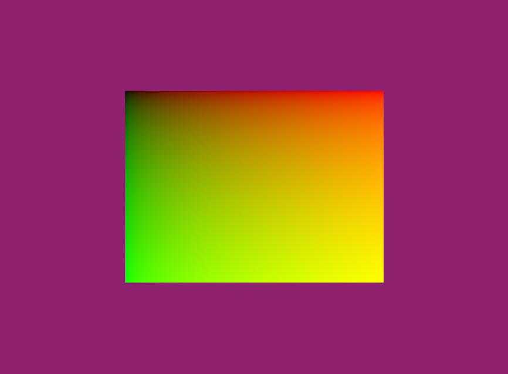
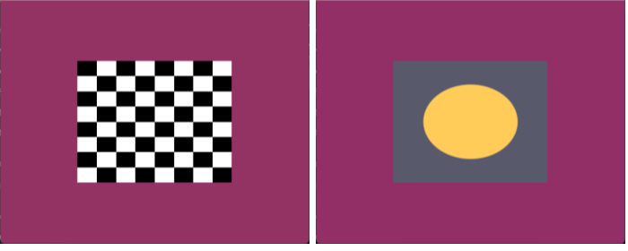
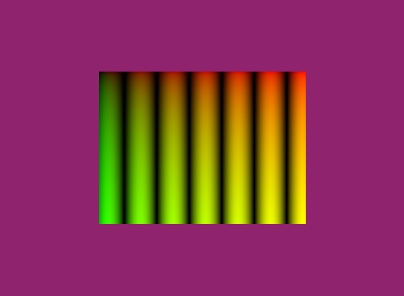

# Lesson 2.3 — GPU Buffers: Vertices, Indices & Your First Mesh

| | |
|---|---|
| **Goal** | Put vertex and index data in GPU memory with VMA, read it in a shader through the project's vertex layout, and draw an indexed quad that shows its UVs |
| **Time** | 2–3 hours |
| **You'll create** | `vk/ImmediateSubmit.h/.cpp`, `vk/Buffer.h/.cpp`, `renderer/Vertex.h`, `shaders/quad.vert`, `shaders/quad.frag` (**you write the shaders**) |
| **You'll change** | `renderer/Renderer.h/.cpp` |
| **Prerequisite** | Lesson 2.2 (triangle on screen) |



This is the **Phase 2 checkpoint**: an indexed quad, drawn from buffers, colored by its UVs.

---

## 1. Concepts

### 1.1 Where meshes live: two kinds of memory

Your laptop's RTX 3050 has its own **VRAM** (4 GB). The CPU can't write into most of it
directly, but the GPU reads it very fast. System **RAM** is the opposite: easy for the CPU,
slow for the GPU to read (it goes over the PCIe bus, and on your laptop sometimes through the
iGPU as well).

| Memory | CPU can write? | GPU reads | Use for |
|---|---|---|---|
| **Device-local (VRAM)** | No | Fast | Meshes, textures: written once, read every frame |
| **Host-visible (RAM, mapped)** | Yes (`memcpy`) | Slower | Upload "trucks" (staging), data that changes every frame |

So meshes get to VRAM in two hops:

```
 CPU array ──memcpy──► staging buffer (host-visible) ──vkCmdCopyBuffer (GPU)──► vertex buffer (VRAM)
                        temporary, deleted after                                 drawn from every frame
```

Tech-art link: this is **what "loading" a mesh or texture actually means**, and why texture
streaming exists. Assets have to cross from RAM to VRAM, and VRAM is limited. When an engine
reports "texture pool over budget", it means the VRAM side is full.

### 1.2 VMA does the memory bookkeeping

Raw Vulkan makes you choose a memory type by hand and suballocate big blocks. VMA (set up in
lesson 1.2) does it from a simple description:

| What you want | `VmaAllocationCreateInfo` |
|---|---|
| Fast GPU memory | `usage = VMA_MEMORY_USAGE_AUTO`, `flags = 0` |
| CPU-writable, permanently mapped | `usage = AUTO`, `flags = HOST_ACCESS_SEQUENTIAL_WRITE \| MAPPED` |

`vmaCreateBuffer` creates the `VkBuffer`, allocates memory, and binds the two in one call.

### 1.3 "Immediate submit": one-off GPU work

The copy from staging to VRAM is a GPU command, so it needs a command buffer and a queue
submit. But it isn't part of a frame: it happens once at load time. `ImmediateSubmit` is a tiny
helper with its own command pool, buffer and fence: **record → submit → wait until done**. It's
simple and blocking, which is fine for loading. Phase 6 reuses it to upload textures.

After the copy, a **buffer barrier** makes the copied bytes visible to the later draws (the
same idea as the image barriers in 1.4, for a buffer this time).

### 1.4 Describing a vertex to the pipeline

A vertex buffer is just bytes. The pipeline needs to know how to slice them into the
shader's inputs. This project has **one fixed vertex layout** for every mesh
([ARCHITECTURE.md §7.2](../../ARCHITECTURE.md)), so every shader you ever write can rely on it:

```
 struct Vertex (48 bytes)
 ┌──────────────────┬──────────────────┬──────────┬────────────────────────┐
 │ position  vec3   │ normal    vec3   │ uv  vec2 │ tangent   vec4         │
 │ bytes 0–11       │ bytes 12–23      │ 24–31    │ bytes 32–47            │
 └──────────────────┴──────────────────┴──────────┴────────────────────────┘
   location 0          location 1         loc 2      location 3

 GLSL:  layout(location = 0) in vec3 inPosition;   ...   layout(location = 2) in vec2 inUV;
```

- **Binding description:** "vertices come from buffer slot 0, and each vertex is 48 bytes (the *stride*)".
- **Attribute descriptions:** one per `location`: "location 2 is two floats, starting at byte 24".

The quad only needs position and UV, but it fills in all four attributes, so Phase 5's
primitives and models drop in with no pipeline changes.

### 1.5 Index buffers: reuse corners

A quad is two triangles = 6 corners, but only 4 *distinct* corners. With an **index buffer**,
you store each corner once and list triangles as index triples:

```
  v0 ───── v1        vertices: v0 v1 v2 v3        (4 × 48 bytes)
  │  ╲     │         indices:  0 1 2   2 3 0       (6 × 4 bytes)
  │    ╲   │                   └─┬─┘   └─┬─┘
  v3 ───── v2                 triangle 1  triangle 2
```

On a real mesh, each vertex is shared by about 6 triangles, so indexing saves a lot of memory,
and the GPU can reuse already-shaded vertices (the post-transform cache). Every mesh from
now on is indexed.

Tech-art link: the **"vertex count" vs "triangle count"** in a DCC or engine stats panel is
exactly this split. UV seams and hard edges **duplicate** vertices (a vertex can only have one
UV and one normal), which is why the engine's vertex count is usually higher than in Maya.

### 1.6 UVs: what the quad shows

UVs are 2D coordinates on the surface, from (0,0) to (1,1), used to place textures. The
project's convention is **(0,0) = top-left**. The quad's fragment shader writes the UV as a
color, `u → red`, `v → green`:

```
  (0,0) black ────────── (1,0) red
     │                       │
  (0,1) green ────────── (1,1) yellow (red + green)
```

This **UV debug view** is a standard tool. Engines have one (Unreal: a `TexCoord` node into
Emissive). Seeing it right confirms that the vertex layout, the attribute offsets and the
interpolation all work.

---

## 2. Build it

### Step 1 — `vk/ImmediateSubmit.h/.cpp`

**`src/vk/ImmediateSubmit.h`**

```cpp
#pragma once

#include <vulkan/vulkan.h>

#include <functional>

namespace vsp {

	class VulkanContext;

	// Record a few commands, submit them, and WAIT until the GPU has finished.
	// For one-off work outside the frame loop: uploading meshes now, textures in Phase 6.
	// Never use it per frame: the CPU stalls until the GPU is done.
	class ImmediateSubmit {
	public:
		void init(VulkanContext& ctx);
		void shutdown();

		void submit(const std::function<void(VkCommandBuffer cmd)>& record);

	private:
		VulkanContext*  m_ctx   = nullptr;
		VkCommandPool   m_pool  = VK_NULL_HANDLE;
		VkCommandBuffer m_cmd   = VK_NULL_HANDLE;
		VkFence         m_fence = VK_NULL_HANDLE;
	};

}
```

**`src/vk/ImmediateSubmit.cpp`**

```cpp
#include "vk/ImmediateSubmit.h"
#include "vk/VulkanContext.h"
#include "vk/VkCheck.h"

namespace vsp {

	void ImmediateSubmit::init(VulkanContext& ctx)
	{
		m_ctx = &ctx;
		VkDevice device = ctx.device();

		VkCommandPoolCreateInfo poolInfo{ VK_STRUCTURE_TYPE_COMMAND_POOL_CREATE_INFO };
		poolInfo.queueFamilyIndex = ctx.graphicsQueueFamily();
		VK_CHECK(vkCreateCommandPool(device, &poolInfo, nullptr, &m_pool));

		VkCommandBufferAllocateInfo allocInfo{ VK_STRUCTURE_TYPE_COMMAND_BUFFER_ALLOCATE_INFO };
		allocInfo.commandPool        = m_pool;
		allocInfo.level              = VK_COMMAND_BUFFER_LEVEL_PRIMARY;
		allocInfo.commandBufferCount = 1;
		VK_CHECK(vkAllocateCommandBuffers(device, &allocInfo, &m_cmd));

		VkFenceCreateInfo fenceInfo{ VK_STRUCTURE_TYPE_FENCE_CREATE_INFO };   // unsignaled: we reset+wait ourselves
		VK_CHECK(vkCreateFence(device, &fenceInfo, nullptr, &m_fence));
	}

	void ImmediateSubmit::shutdown()
	{
		if (m_ctx == nullptr) return;
		VkDevice device = m_ctx->device();
		vkDestroyFence(device, m_fence, nullptr);
		vkDestroyCommandPool(device, m_pool, nullptr);   // frees m_cmd too
		m_fence = VK_NULL_HANDLE;
		m_pool  = VK_NULL_HANDLE;
		m_cmd   = VK_NULL_HANDLE;
		m_ctx   = nullptr;
	}

	void ImmediateSubmit::submit(const std::function<void(VkCommandBuffer cmd)>& record)
	{
		VkDevice device = m_ctx->device();

		VK_CHECK(vkResetFences(device, 1, &m_fence));
		VK_CHECK(vkResetCommandPool(device, m_pool, 0));

		VkCommandBufferBeginInfo beginInfo{ VK_STRUCTURE_TYPE_COMMAND_BUFFER_BEGIN_INFO };
		beginInfo.flags = VK_COMMAND_BUFFER_USAGE_ONE_TIME_SUBMIT_BIT;
		VK_CHECK(vkBeginCommandBuffer(m_cmd, &beginInfo));
		record(m_cmd);                                    // the caller writes its commands here
		VK_CHECK(vkEndCommandBuffer(m_cmd));

		VkCommandBufferSubmitInfo cmdInfo{ VK_STRUCTURE_TYPE_COMMAND_BUFFER_SUBMIT_INFO };
		cmdInfo.commandBuffer = m_cmd;

		VkSubmitInfo2 submitInfo{ VK_STRUCTURE_TYPE_SUBMIT_INFO_2 };
		submitInfo.commandBufferInfoCount = 1;
		submitInfo.pCommandBufferInfos    = &cmdInfo;

		VK_CHECK(vkQueueSubmit2(m_ctx->graphicsQueue(), 1, &submitInfo, m_fence));
		VK_CHECK(vkWaitForFences(device, 1, &m_fence, VK_TRUE, UINT64_MAX));   // block until done
	}

}
```

Compare it with `drawFrame` from 1.4: the same steps (reset → record → submit with a fence),
minus the swapchain, plus **waiting right away**. The `std::function` parameter lets the
caller pass a lambda with "what to record".

### Step 2 — `vk/Buffer.h/.cpp`

**`src/vk/Buffer.h`**

```cpp
#pragma once

#include <vulkan/vulkan.h>
#include <vk_mem_alloc.h>

namespace vsp {

	class VulkanContext;
	class ImmediateSubmit;

	// A VkBuffer plus the VMA memory behind it.
	struct AllocatedBuffer {
		VkBuffer          buffer     = VK_NULL_HANDLE;
		VmaAllocation     allocation = VK_NULL_HANDLE;
		VmaAllocationInfo info{};                       // info.pMappedData is set for CPU-visible buffers
		VkDeviceSize      size       = 0;
	};

	// flags = 0                       -> fast GPU memory (VRAM), CPU cannot write it
	// flags = HOST_ACCESS_SEQUENTIAL_WRITE | MAPPED -> CPU-writable, permanently mapped (staging, per-frame data)
	AllocatedBuffer createBuffer(VmaAllocator allocator, VkDeviceSize size,
	                             VkBufferUsageFlags usage, VmaAllocationCreateFlags flags = 0);

	void destroyBuffer(VmaAllocator allocator, AllocatedBuffer& buffer);

	// Create a buffer in VRAM and fill it with `data` through a temporary staging buffer.
	AllocatedBuffer createGpuBuffer(VulkanContext& ctx, ImmediateSubmit& immediate,
	                                const void* data, VkDeviceSize size, VkBufferUsageFlags usage);

}
```

**`src/vk/Buffer.cpp`**

```cpp
#include "vk/Buffer.h"
#include "vk/VulkanContext.h"
#include "vk/ImmediateSubmit.h"
#include "vk/VkCheck.h"

#include <cstring>

namespace vsp {

	AllocatedBuffer createBuffer(VmaAllocator allocator, VkDeviceSize size,
	                             VkBufferUsageFlags usage, VmaAllocationCreateFlags flags)
	{
		VkBufferCreateInfo bufferInfo{ VK_STRUCTURE_TYPE_BUFFER_CREATE_INFO };
		bufferInfo.size        = size;
		bufferInfo.usage       = usage;
		bufferInfo.sharingMode = VK_SHARING_MODE_EXCLUSIVE;

		VmaAllocationCreateInfo allocInfo{};
		allocInfo.usage = VMA_MEMORY_USAGE_AUTO;   // VMA picks the memory type from usage + flags
		allocInfo.flags = flags;

		AllocatedBuffer result;
		result.size = size;
		VK_CHECK(vmaCreateBuffer(allocator, &bufferInfo, &allocInfo,
		                         &result.buffer, &result.allocation, &result.info));
		return result;
	}

	void destroyBuffer(VmaAllocator allocator, AllocatedBuffer& buffer)
	{
		if (buffer.buffer != VK_NULL_HANDLE)
			vmaDestroyBuffer(allocator, buffer.buffer, buffer.allocation);
		buffer = AllocatedBuffer{};
	}

	AllocatedBuffer createGpuBuffer(VulkanContext& ctx, ImmediateSubmit& immediate,
	                                const void* data, VkDeviceSize size, VkBufferUsageFlags usage)
	{
		VmaAllocator allocator = ctx.allocator();

		// 1. Staging buffer: CPU-visible, so we can memcpy into it
		AllocatedBuffer staging = createBuffer(allocator, size, VK_BUFFER_USAGE_TRANSFER_SRC_BIT,
			VMA_ALLOCATION_CREATE_HOST_ACCESS_SEQUENTIAL_WRITE_BIT | VMA_ALLOCATION_CREATE_MAPPED_BIT);
		std::memcpy(staging.info.pMappedData, data, static_cast<size_t>(size));

		// 2. The real buffer: in VRAM, and a valid copy destination
		AllocatedBuffer gpu = createBuffer(allocator, size, usage | VK_BUFFER_USAGE_TRANSFER_DST_BIT);

		// 3. Let the GPU copy staging -> VRAM, and wait for it
		immediate.submit([&](VkCommandBuffer cmd) {
			VkBufferCopy region{ 0, 0, size };   // srcOffset, dstOffset, size
			vkCmdCopyBuffer(cmd, staging.buffer, gpu.buffer, 1, &region);

			// Make the copied bytes visible to everything that reads this buffer later
			VkBufferMemoryBarrier2 barrier{ VK_STRUCTURE_TYPE_BUFFER_MEMORY_BARRIER_2 };
			barrier.srcStageMask        = VK_PIPELINE_STAGE_2_COPY_BIT;
			barrier.srcAccessMask       = VK_ACCESS_2_TRANSFER_WRITE_BIT;
			barrier.dstStageMask        = VK_PIPELINE_STAGE_2_ALL_COMMANDS_BIT;
			barrier.dstAccessMask       = VK_ACCESS_2_MEMORY_READ_BIT;
			barrier.srcQueueFamilyIndex = VK_QUEUE_FAMILY_IGNORED;
			barrier.dstQueueFamilyIndex = VK_QUEUE_FAMILY_IGNORED;
			barrier.buffer              = gpu.buffer;
			barrier.size                = VK_WHOLE_SIZE;

			VkDependencyInfo dep{ VK_STRUCTURE_TYPE_DEPENDENCY_INFO };
			dep.bufferMemoryBarrierCount = 1;
			dep.pBufferMemoryBarriers    = &barrier;
			vkCmdPipelineBarrier2(cmd, &dep);
		});

		// 4. The staging buffer has done its job
		destroyBuffer(allocator, staging);
		return gpu;
	}

}
```

Two details:
- **`usage` flags** say what the buffer will be used for: `TRANSFER_SRC` (copy from),
  `TRANSFER_DST` (copy into), `VERTEX_BUFFER`, `INDEX_BUFFER`, later `UNIFORM_BUFFER`. Vulkan
  checks them, and VMA uses them to pick memory.
- **The barrier uses `ALL_COMMANDS` / `MEMORY_READ`** as its destination: "everything after
  this may read it". It's broad on purpose, so the same upload function works for vertex,
  index and uniform buffers. It runs once at load time, so the cost doesn't matter.

### Step 3 — `renderer/Vertex.h`

The vertex struct and its description for the pipeline, in one header. It's in `renderer/`
because it uses Vulkan types (`vk/` must not know about meshes, see ARCHITECTURE §3).

```cpp
#pragma once

#include <vulkan/vulkan.h>
#include <glm/glm.hpp>

#include <array>
#include <cstddef>   // offsetof

namespace vsp {

	// The ONE vertex layout of this project (ARCHITECTURE.md §7.2).
	// Every mesh (quad now, primitives and models in Phase 5) uses it, so every shader can rely on it.
	struct Vertex {
		glm::vec3 position;   // location 0
		glm::vec3 normal;     // location 1
		glm::vec2 uv;         // location 2
		glm::vec4 tangent;    // location 3
	};

	// "Vertices come from buffer binding 0, one Vertex after another"
	inline VkVertexInputBindingDescription vertexBinding()
	{
		VkVertexInputBindingDescription binding{};
		binding.binding   = 0;
		binding.stride    = sizeof(Vertex);               // bytes from one vertex to the next (48)
		binding.inputRate = VK_VERTEX_INPUT_RATE_VERTEX;  // advance once per vertex (not per instance)
		return binding;
	}

	// "location N is this many floats, starting at this byte inside a Vertex"
	inline std::array<VkVertexInputAttributeDescription, 4> vertexAttributes()
	{
		return { {
			{ 0, 0, VK_FORMAT_R32G32B32_SFLOAT,    static_cast<uint32_t>(offsetof(Vertex, position)) },
			{ 1, 0, VK_FORMAT_R32G32B32_SFLOAT,    static_cast<uint32_t>(offsetof(Vertex, normal))   },
			{ 2, 0, VK_FORMAT_R32G32_SFLOAT,       static_cast<uint32_t>(offsetof(Vertex, uv))       },
			{ 3, 0, VK_FORMAT_R32G32B32A32_SFLOAT, static_cast<uint32_t>(offsetof(Vertex, tangent))  },
		} };   // { location, binding, format, offset }
	}

}
```

`VK_FORMAT_R32G32B32_SFLOAT` reads as "three 32-bit signed floats", i.e. a `vec3`. Formats
describe vertex data with the same names as image formats.

### Step 4 — Write the quad shaders (exercise)

**`shaders/quad.vert`** must:
- declare the four inputs from §1.4 with `layout(location = N) in`, matching `Vertex.h`
  (`vec3 inPosition`, `vec3 inNormal`, `vec2 inUV`, `vec4 inTangent`),
- declare one output: `layout(location = 0) out vec2 vUV;`,
- in `main()`: `gl_Position` = the position with `w = 1.0` (still clip space, no camera yet),
  and pass the UV through.

**`shaders/quad.frag`** must:
- take `vUV` in and output `outColor`,
- write the **UV debug view**: red = u, green = v, blue = 0, alpha = 1.

<details><summary>Hint: one line for the fragment shader</summary>

`vUV` is a `vec2`, and `vec4(vUV, 0.0, 1.0)` spills it into red and green.
</details>

<details><summary>Solution: quad.vert</summary>

```glsl
#version 450

// Must match vertexAttributes() in renderer/Vertex.h
layout(location = 0) in vec3 inPosition;
layout(location = 1) in vec3 inNormal;
layout(location = 2) in vec2 inUV;
layout(location = 3) in vec4 inTangent;

layout(location = 0) out vec2 vUV;

void main()
{
    gl_Position = vec4(inPosition, 1.0);   // still clip space: no camera until Phase 3
    vUV         = inUV;
}
```

`inNormal` and `inTangent` are declared but unused. That's allowed, and documents the layout.
</details>

<details><summary>Solution: quad.frag</summary>

```glsl
#version 450

layout(location = 0) in  vec2 vUV;
layout(location = 0) out vec4 outColor;

void main()
{
    // UV debug view: u -> red, v -> green.
    // Top-left (0,0) black, top-right (1,0) red, bottom-left (0,1) green, bottom-right (1,1) yellow.
    outColor = vec4(vUV, 0.0, 1.0);
}
```
</details>

### Step 5 — `Renderer`: build the quad, draw it

**`Renderer.h`**: includes at the top:

```cpp
#include "vk/Buffer.h"
#include "vk/ImmediateSubmit.h"
```

private functions:

```cpp
		void createQuad();
		void destroyQuad();
```

members: **rename** `m_trianglePipeline` to `m_quadPipeline` and add the rest:

```cpp
		VkPipeline				m_quadPipeline     = VK_NULL_HANDLE;

		ImmediateSubmit			m_immediate;
		AllocatedBuffer			m_vertexBuffer;
		AllocatedBuffer			m_indexBuffer;
		uint32_t				m_indexCount = 0;
```

**`Renderer.cpp`**

Include:

```cpp
#include "renderer/Vertex.h"
```

`init()`: the order matters, because the quad upload needs `m_immediate`:

```cpp
	m_swapchain.init(ctx, { fb.width, fb.height }, m_vsync);
	createFrames();
	m_immediate.init(ctx);
	createPipelines();
	createQuad();
```

`shutdown()`: reverse order:

```cpp
	vkDeviceWaitIdle(m_ctx->device());   // never destroy things the GPU is still using
	destroyQuad();
	destroyPipelines();
	m_immediate.shutdown();
	destroyFrames();
	m_swapchain.shutdown();
	m_ctx = nullptr;
```

`createPipelines()`: load the quad shaders and **add the vertex input**:

```cpp
	VkShaderModule vert = vkutil::loadShaderModule(device, vkutil::shaderPath("quad.vert"));
	VkShaderModule frag = vkutil::loadShaderModule(device, vkutil::shaderPath("quad.frag"));

	const VkVertexInputBindingDescription binding    = vertexBinding();
	const auto                            attributes = vertexAttributes();

	m_quadPipeline = PipelineBuilder{}
		.shaders(vert, frag)
		.vertexInput({ &binding, 1 }, attributes)   // NEW: vertices come from a buffer now
		.colorFormat(m_swapchain.format())
		.build(device, m_pipelineLayout);
```

`{ &binding, 1 }` builds a one-element `std::span` from a pointer and a count.

`destroyPipelines()`: `m_trianglePipeline` becomes `m_quadPipeline` (two places).

**The two new functions**:

```cpp
void vsp::Renderer::createQuad()
{
	// 4 corners in Vulkan clip space (y points DOWN). UV (0,0) = top-left, as textures expect.
	//
	//   v0 (-0.5,-0.5) ---- v1 ( 0.5,-0.5)
	//        |          ╲         |
	//   v3 (-0.5, 0.5) ---- v2 ( 0.5, 0.5)
	//
	const glm::vec3 n{ 0.0f, 0.0f, 1.0f };            // facing the viewer (used from Phase 5 on)
	const glm::vec4 t{ 1.0f, 0.0f, 0.0f, 1.0f };      // along +u (normal mapping, Phase 8)
	const Vertex vertices[] = {
		{ { -0.5f, -0.5f, 0.0f }, n, { 0.0f, 0.0f }, t },   // v0 top-left
		{ {  0.5f, -0.5f, 0.0f }, n, { 1.0f, 0.0f }, t },   // v1 top-right
		{ {  0.5f,  0.5f, 0.0f }, n, { 1.0f, 1.0f }, t },   // v2 bottom-right
		{ { -0.5f,  0.5f, 0.0f }, n, { 0.0f, 1.0f }, t },   // v3 bottom-left
	};
	const uint32_t indices[] = { 0, 1, 2,   2, 3, 0 };    // two triangles sharing the v0-v2 edge

	m_vertexBuffer = createGpuBuffer(*m_ctx, m_immediate, vertices, sizeof(vertices),
	                                 VK_BUFFER_USAGE_VERTEX_BUFFER_BIT);
	m_indexBuffer  = createGpuBuffer(*m_ctx, m_immediate, indices, sizeof(indices),
	                                 VK_BUFFER_USAGE_INDEX_BUFFER_BIT);
	m_indexCount   = 6;
}

void vsp::Renderer::destroyQuad()
{
	destroyBuffer(m_ctx->allocator(), m_indexBuffer);
	destroyBuffer(m_ctx->allocator(), m_vertexBuffer);
	m_indexCount = 0;
}
```

`recordCommands()`: bind `m_quadPipeline` instead of the triangle pipeline, and replace the
`vkCmdDraw(cmd, 3, 1, 0, 0);` line with:

```cpp
	// Where the vertices and indices come from
	VkDeviceSize offset = 0;
	vkCmdBindVertexBuffers(cmd, 0, 1, &m_vertexBuffer.buffer, &offset);   // binding 0
	vkCmdBindIndexBuffer(cmd, m_indexBuffer.buffer, 0, VK_INDEX_TYPE_UINT32);

	// 6 indices = 2 triangles, built from only 4 vertices
	vkCmdDrawIndexed(cmd, m_indexCount, 1, 0, 0, 0);
```

Keep `triangle.vert/.frag` in `shaders/`. They're harmless, and they're your first shaders.

---

## 3. Checkpoint ✅ (Phase 2 complete)

- [ ] **The UV quad**: black top-left, red top-right, green bottom-left, yellow bottom-right, as in the image at the top
- [ ] The log shows `quad.vert.spv` and `quad.frag.spv` being loaded
- [ ] Resizing: the quad stretches with the window (aspect correction comes in 3.1), and there are no validation messages
- [ ] Clean exit with **zero validation messages**. Forgetting `destroyQuad()` makes VMA complain about leaked allocations, and the validation layer names the leaked buffers

Commit: `git commit -am "Lesson 2.3: VMA buffers, vertex layout, indexed UV quad"`

Then tick Phase 2 in [ROADMAP.md](../../ROADMAP.md). 🎉

---

## 4. Shader practice: your first procedural patterns

This is the part that transfers directly to material work. Each exercise replaces
`main()` in **`quad.frag`** (keep the `in`/`out` lines). Save, build, run. Try each one
before opening the solution. The solutions are compile-checked, and 2 and 3 are the
images below.



**1. Two-color gradient.** Blend from a deep blue at the top to orange at the bottom.
*Tools:* `mix`, `vUV.y`.

<details><summary>Solution</summary>

```glsl
void main()
{
    vec3 top    = vec3(0.05, 0.10, 0.30);   // deep blue
    vec3 bottom = vec3(1.00, 0.55, 0.20);   // orange
    outColor = vec4(mix(top, bottom, vUV.y), 1.0);
}
```
</details>

**2. Checkerboard, 8×8.** *Tools:* `floor`, `mod`. Hint: `floor(vUV * 8.0)` tells you which
cell you're in; if `cell.x + cell.y` is even, use black, otherwise white.

<details><summary>Solution</summary>

```glsl
void main()
{
    vec2  cell    = floor(vUV * 8.0);                 // which of the 8x8 cells: (0..7, 0..7)
    float checker = mod(cell.x + cell.y, 2.0);        // alternates 0, 1, 0, 1 ...
    outColor = vec4(vec3(checker), 1.0);
}
```
</details>

**3. A soft-edged circle** in the middle. *Tools:* `distance`, `smoothstep`, `mix`.
Then notice: **it's an ellipse**. Why? (Answer in the solution.)

<details><summary>Solution</summary>

```glsl
void main()
{
    float d      = distance(vUV, vec2(0.5));          // 0 at the center
    float circle = 1.0 - smoothstep(0.30, 0.31, d);   // 1 inside, 0 outside, soft 0.01 edge
    vec3  bg     = vec3(0.10, 0.10, 0.15);
    vec3  fg     = vec3(1.00, 0.60, 0.10);
    outColor = vec4(mix(bg, fg, circle), 1.0);
}
```

UV space is always 0..1 in both directions, but the quad on screen is wider than tall (it
stretches with the window). A circle in UV space becomes an ellipse on a non-square surface.
In Phase 3 the quad gets a proper aspect ratio. In materials, the same thing happens on any
non-square UV island. Try `smoothstep(0.30, 0.40, d)` for a much softer edge.
</details>

**4. UV grid overlay** (a real debug tool). Draw the UV colors from the checkpoint, plus
white lines every 0.1 in u and v. *Tools:* `fract`, `step`, `max`, `mix`.

<details><summary>Solution</summary>

```glsl
void main()
{
    vec2  cell = fract(vUV * 10.0);                    // 0..1 inside each of 10x10 cells
    float line = step(0.95, max(cell.x, cell.y));      // 1 near the right/bottom edge of a cell
    vec3  base = vec3(vUV, 0.0);                       // the UV debug colors
    outColor = vec4(mix(base, vec3(1.0), line), 1.0);
}
```

This is how UV-checker textures work: stretching or squashing of the squares shows UV
distortion on a model. You'll use it on spheres and imported models in Phase 5.
</details>

---

## 5. Common pitfalls

| Symptom | Cause / fix |
|---|---|
| Nothing drawn, no errors | `vkCmdDrawIndexed` count is 0, or the index buffer isn't bound |
| Garbage triangles / spikes | `stride` or an `offset` in `Vertex.h` doesn't match the struct (always use `sizeof`/`offsetof`, never hand-counted numbers) |
| Validation: vertex attribute location N not consumed / not provided | A shader `in` location has no matching attribute, or the other way round |
| Validation: buffer usage missing `VERTEX_BUFFER_BIT` (or `TRANSFER_DST_BIT`) | `usage` flags at creation don't cover how the buffer is used |
| Colors swapped: green on top | UVs or positions are flipped. Remember y points down in clip space and (0,0) is top-left in UV |
| VMA assert or leak report on exit | `destroyQuad()` missing, or called after `m_vk.shutdown()` destroyed the allocator |

---

## 6. Check your understanding

1. Why not just create the vertex buffer in host-visible memory and `memcpy` into it every time?
2. What does `ImmediateSubmit::submit` wait on, and why is that fine here but terrible in `drawFrame`?
3. The quad has 4 vertices and 6 indices. A cube with sharp edges has 8 corners. How many vertices does it need, and why not 8?
4. What would break if `binding.stride` were `sizeof(glm::vec3)`?
5. In the UV debug view, which corner is yellow, and why?

<details><summary>Answers</summary>

1. Host-visible memory is slow for the GPU to read every frame. Meshes are written once and
   read constantly, so they belong in VRAM. Staging is the one-time cost to get them there.
   (Data that changes every frame, like camera matrices in 3.2, does live in host-visible memory.)
2. Its own fence, so the CPU blocks until the GPU has finished the copy. For a one-off upload
   at load time that's fine. In the frame loop it would kill the CPU/GPU overlap that frames
   in flight give you.
3. 24: 4 per face × 6 faces. A vertex has exactly one normal (and one UV). A cube corner
   touches 3 faces with 3 different normals, so it has to be split into 3 vertices. That's the
   "vertex count is higher than you'd think" effect from §1.5.
4. The GPU would step only 12 bytes from one vertex to the next, landing inside the previous
   vertex's normal. Every vertex after the first would read the wrong bytes: garbage shapes.
5. Bottom-right: UV (1, 1) → red = 1, green = 1 → red + green light = yellow.
</details>

---

## 7. Stretch goals

### Animate with a push constant (tested)

A **push constant** is a tiny block of data (up to 128 bytes) that you write straight into the
command buffer, with no buffer needed. Lesson 3.2 covers it properly; here's the minimal
version, so you can animate your practice shaders right now.



**`createPipelines()`**: give the layout one push-constant range:

```cpp
	VkPushConstantRange pushRange{};
	pushRange.stageFlags = VK_SHADER_STAGE_FRAGMENT_BIT;   // only the fragment shader reads it
	pushRange.offset     = 0;
	pushRange.size       = sizeof(float);                  // one float: the time

	VkPipelineLayoutCreateInfo layoutInfo{ VK_STRUCTURE_TYPE_PIPELINE_LAYOUT_CREATE_INFO };
	layoutInfo.pushConstantRangeCount = 1;
	layoutInfo.pPushConstantRanges    = &pushRange;
	VK_CHECK(vkCreatePipelineLayout(device, &layoutInfo, nullptr, &m_pipelineLayout));
```

**`recordCommands()`**: just before `vkCmdDrawIndexed`:

```cpp
	const float time = static_cast<float>(timeSeconds);
	vkCmdPushConstants(cmd, m_pipelineLayout, VK_SHADER_STAGE_FRAGMENT_BIT, 0, sizeof(float), &time);
```

**`quad.frag`**:

```glsl
#version 450

layout(location = 0) in  vec2 vUV;
layout(location = 0) out vec4 outColor;

layout(push_constant) uniform Push {
    float time;   // seconds since start, sent by vkCmdPushConstants every frame
} pc;

void main()
{
    // Stripes that scroll over time
    float stripes = 0.5 + 0.5 * sin(vUV.x * 40.0 - pc.time * 3.0);
    outColor = vec4(vUV * stripes, 0.0, 1.0);
}
```

Now animate the practice shaders: a pulsing circle radius (`0.3 + 0.05 * sin(pc.time)`), a
scrolling checkerboard (`floor(vUV * 8.0 + vec2(pc.time, 0.0))`), a gradient whose colors cycle.

### More

- **Draw two quads** from the same buffers: call `vkCmdDrawIndexed` twice with a different
  `vertexOffset`... and notice there's no way yet to *move* the second one. That's exactly
  what the model matrix in 3.1/3.2 solves.
- **Read** [Vulkan Guide: Vertex buffers / mesh buffers](https://vkguide.dev/docs/new_chapter_3/mesh_buffers/)
  for a second explanation of the same ideas with the same API.

---

## Phase 2 complete 🎉

Before you move on:
- [ ] The UV quad renders with zero validation messages
- [ ] You did at least practice exercises 2 and 3 yourself
- [ ] `git log` shows one commit per lesson

Then ask Claude: **"Review my Phase 2 code."** After the review, Phase 3 gets written: 3D math
(model/view/projection), push constants and uniform buffers, the depth buffer, and an orbit
camera, so the quad becomes a spinning cube you can fly around.
